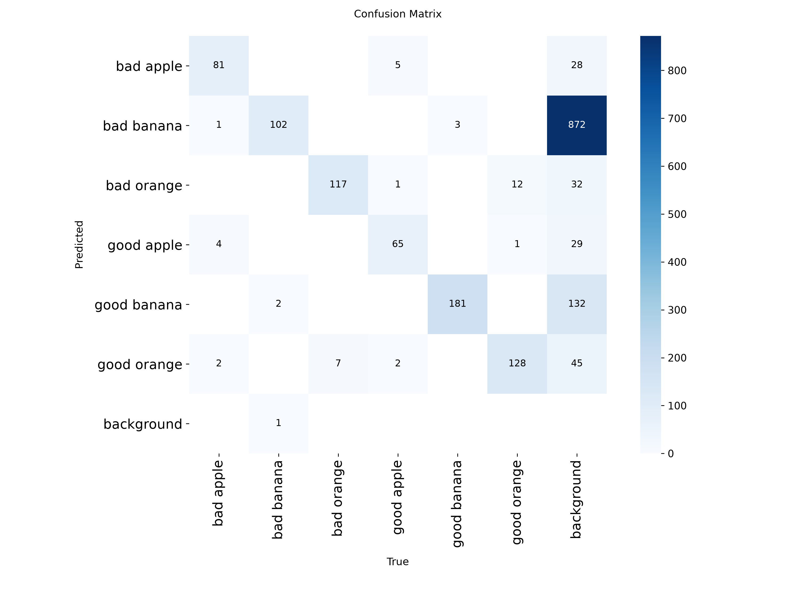
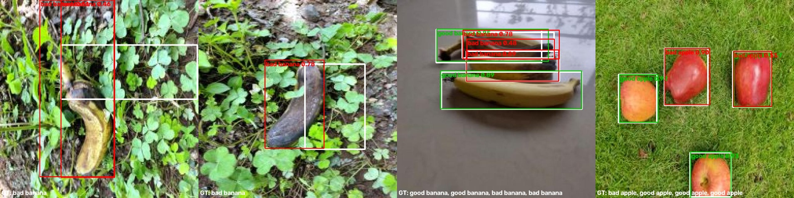
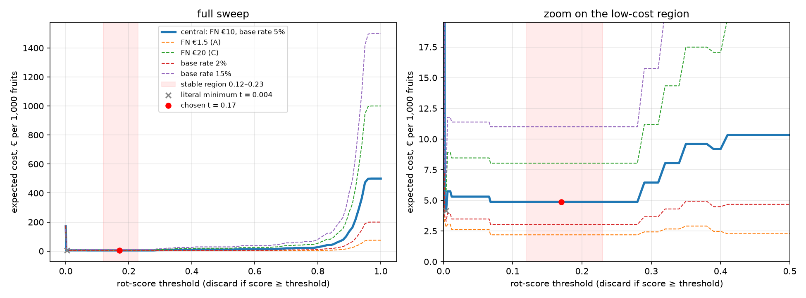

# Assignment 2 Report

- **Name**: Eduardo Alfaro
- **Student ID**: 19911
- **Email**: ealfaro.ieu2022@student.ie.edu
- **Group**: BBADBA 5B

## Business problem, and the cost of being wrong

This model supports a simple decision on a fruit packing line: a worker looks at each fruit and decides whether to pack it or throw it away. The model does not replace the worker; it helps the worker make that call fruit by fruit.

I set the positive class as **rotten**, which means any `bad *` fruit is positive and any `good *` fruit is negative. That makes the two kinds of mistakes easy to interpret:

- **False positive**: a good fruit is marked as rotten and thrown away.
- **False negative**: a rotten fruit is marked as good and packed.

The two mistakes do not cost the same. Throwing away a good fruit costs about **€0.18** per fruit. Missing a rotten fruit costs about **€10** in the main case I used, because it can spoil nearby fruit, damage the carton, or lead to a downgrade or rejection later in the supply chain. So one packed rotten fruit is roughly as bad as throwing away about **55 good fruits**. That asymmetry drives everything else in the report: the threshold, how much gets sent to a person, and which operating point makes sense. Where each figure comes from is in the cost section below.

## Dataset

I used the Roboflow Universe dataset **`rotten-fruit-detector`**, from workspace **`deep-learning-computer-vision-project`**, version **3** (public, CC BY 4.0, used as it is, not forked):

https://universe.roboflow.com/deep-learning-computer-vision-project/rotten-fruit-detector/dataset/3

This is an **object detection** dataset. Each image is a photo of one or more fruits, with a bounding box around each fruit. The classes are:

- `bad apple`
- `bad banana`
- `bad orange`
- `good apple`
- `good banana`
- `good orange`

I chose this dataset because it matches the real decision better than plain classification. On a packing line, there can be more than one fruit in the frame, and the choice is made per fruit, not just per image. So I need a detector that finds each fruit and labels it as rotten or good. I also preferred it over other candidates because it has a published version (so it can be downloaded again exactly), clean class names, and no augmentation, so the test set has no augmented copies of training images.

## What the dataset's composition implies

The dataset has **2,316 train images**, **658 validation images**, and **330 test images** (a 70/20/10 split made by the uploader, all resized to 640×640).

Instances per class:

| Class | Train | Validation | Test | Median box area (share of image) |
|---|---:|---:|---:|---:|
| bad apple | 641 | 160 | 88 | 12.7% |
| bad banana | 726 | 182 | 105 | 19.0% |
| bad orange | 992 | 295 | 124 | 10.9% |
| good apple | 604 | 150 | 73 | 12.8% |
| good banana | 1,237 | 337 | 184 | 21.4% |
| good orange | 1,122 | 356 | 141 | 6.1% |

The number of **images** per class is almost perfectly balanced (around 420 per class in train), so the dataset was clearly built to give each class a fair share. The number of **instances** is less balanced, because banana and orange photos often contain several fruits (in train there are 1,237 good bananas but only 604 good apples).

Rotten fruit is about **44%** of the test instances. That is much higher than the 5% I expect on a real line, so I never read the cost straight off the test counts (see the cost section).

The fruit is also fairly large in the frame. Median box size is about **6% to 21% of the image area**, depending on class. So these are not tiny objects hidden in clutter.

A few things follow from that:

- The thinnest per-class test numbers are **bad apple** (88) and **good apple** (73), so those per-class results are a bit less stable. One mistake changes recall by more than a point.
- Every image contains fruit, and there are no empty images. That means the test set only checks "rotten or fresh?", not "is there any fruit here at all?"
- Every image shows a single fruit type. So the test set does not fully reflect the mixed scenes you would expect on a real packing line.
- The photos also do **not** look like a conveyor belt. They are mostly fruit held in a hand or lying on grass, pavement, or a tablecloth. That means I can trust the model learned this dataset, but I cannot conclude that the same score will transfer directly to a real factory camera.
- I suspected possible leakage: from the camera timestamps in the file names, **150 of the 330 test images were taken in the same minute as a training image**, probably the same fruit photographed again. I checked whether this inflates the score. On fruits from capture sessions that do **not** appear in training, the model made **1 error out of 342** at a 0.5 threshold, against **7 out of 373** on the shared sessions. So I found **no evidence** that the overlap inflates the result.

So the main thing I cannot conclude from the results is production performance on a real packing line. The dataset is useful, but it is not the same as the deployment setting.

## Finetuning and baselines

I used **object detection**, not classification, because the decision is per fruit and there can be several fruits in one image.

The finetuned model was **YOLO11n**, starting from COCO-pretrained weights. I trained it on **Google Colab with a Tesla T4 GPU**, because my laptop has no GPU and one epoch on CPU took about 11 minutes. Settings: **50 epochs**, image size **640**, batch **16**, early stopping patience 15 (it never triggered), seed 0. Training took about **28 minutes**. The best epoch was the last one, but the validation curve was already almost flat. The weights are committed in `weights/best.pt`, and the exact settings are in `weights/training_info.json`.

I compared it with two baselines on the **same test split**:

1. **COCO zero-shot YOLO11n**: the pretrained model only knows apple, banana and orange, so I mapped each to the matching `good` class. It can find fruit but can never say "rotten".
2. **Predict nothing**: no detections, so every fruit is packed.

| Model | mAP50 | mAP50-95 | Rotten recall @ 0.5 | Rotten precision @ 0.5 | € per 1,000 at its best threshold |
|---|---:|---:|---:|---:|---:|
| Finetuned YOLO11n | 0.993 | 0.902 | 0.981 | 0.994 | **4.87** (chosen t = 0.17) |
| COCO zero-shot YOLO11n | 0.172 | 0.123 | 0.000 | – | 171.0 |
| Predict nothing | 0.000 | 0.000 | 0.000 | – | 171.0 |

(mAP here is computed the same way for all three models on the same test images. The official Ultralytics test metrics for the finetuned model are mAP50 **0.993** and mAP50-95 **0.907**.)

The finetuned model is much better than both baselines. The COCO model can detect fruit, but it has no real idea of "rotten", so for this task it behaves exactly like the trivial baseline. At any threshold above 0 it packs everything (€500 per 1,000), and its cheapest option is actually to discard everything (€171 per 1,000). The jump is large, and honestly about as large as I hoped for once the model saw the correct labels.

## Per-class evaluation and failure modes

The model is strong overall, but not every class is equally strong (Ultralytics test metrics):

| Class | Precision | Recall | AP50 | AP50-95 |
|---|---:|---:|---:|---:|
| bad apple | 0.995 | 1.000 | 0.995 | 0.908 |
| bad banana | 0.990 | 0.932 | 0.987 | 0.885 |
| bad orange | 0.997 | 1.000 | 0.995 | 0.907 |
| good apple | 1.000 | 0.999 | 0.995 | 0.950 |
| good banana | 0.984 | 0.986 | 0.992 | 0.892 |
| good orange | 1.000 | 0.999 | 0.995 | 0.899 |

The headline result is carried mostly by the apples and oranges, which are all around **0.995 AP50**. The class dragging the most is **bad banana**, because it has the lowest recall and the lowest AP50-95.

The confusion matrix shows **no confusion at all between classes**: the model never calls a rotten fruit fresh or a fresh fruit rotten once it has found the fruit, and it never mixes up fruit types. All errors are fruit-versus-background: it misses a fruit, or it puts extra boxes on banana fragments. At my chosen threshold of 0.17, the rotten-vs-good decision per fruit on the test set is **315 true positives, 2 false negatives, 4 false positives and 394 true negatives**.

In the failure analysis, banana was also the most ambiguous class. Some examples labelled as `bad banana` looked more like ripe or spotted bananas than clearly rotten fruit, so label ambiguity is probably part of the problem too.

A few specific failure modes stood out:

- Some missed rotten bananas were actually label problems, not model problems. The model drew a bad-banana box on the banana, but the ground-truth box was shifted, so IoU dropped below 0.5.
- Banana bunches are messy. Overlapping bananas make the boxes harder to separate, and that is where some false positives come from.
- Some red apples on grass were labelled as good, but the model called them bad apple with high confidence. Looking at them, those labels are debatable, so the model may actually be reacting to a real visual ambiguity.

So the model works well, but the weak point is clearly bananas, especially around borderline or messy cases.

## Cost matrix and operating point

I used these costs:

- **False positive**: about **€0.18** per fruit
- **False negative**: about **€10** per fruit in the main case
- **True positive and true negative**: **€0** (a rotten fruit thrown away had no value anyway, and a good fruit packed is the normal outcome)
- **Review cost**: about **€0.017** per fruit, based on **€12/hour** and **5 seconds** per check

Where the figures come from:

- **€0.18**: EU producer prices in 2025 were about €0.60–1.30 per kg for apples and €1.10–1.50 per kg for bananas (European Commission market dashboards, reported by FreshPlaza), and one fruit weighs about 0.15–0.2 kg. I did not find a reliable orange price, so I assumed a similar value.
- **€10**: a carton holds about 18 kg, roughly 100 fruits, worth about €18 at producer price. Rot such as blue mould spreads by contact to damaged neighbouring fruit, and the retailer's quality check can downgrade or repack the carton. €10 is part of that carton value. I also tested a low case, **€1.5** (one consumer complaint and refund), and a high case, **€20** (the fruit contributes to a whole load being rejected, which is then resold at a 20–30% discount or returned).
- **€12/hour**: Spain's 2025 minimum wage (€1,184 × 14 payments a year, about €9.3/hour gross) plus employer social security.

The base rate I used was **5% rotten**, with sensitivity checks at **2%** and **10–15%**. Published postharvest rot losses in apples range from about 1% to 15%, so 5% is a middle value. One important thing here is that the test set itself is much more rotten than that (44%), so I do **not** read cost straight off the test counts. I measure the per-class rates on the test set, then re-weight them to the real base rate: per 1,000 fruits, 50 rotten and 950 good.

A first finding: the cheapest trivial strategy is **not** packing everything (50 × €10 = **€500** per 1,000) but **discarding everything** (950 × €0.18 = **€171** per 1,000). Discarding everything beats packing everything whenever the base rate is above about **1.8%**. So the real bar the model has to beat is €171, not €500.

I swept the threshold from 0 to 1 (in steps of 0.002 below 0.1, where the curve moves fastest, and 0.01 above) and computed the expected cost at each point:

The literal minimum cost was about **€4.16 per 1,000 fruits** at a threshold of **0.004**. I did not choose that blindly. It was fragile, because the difference with the flat part of the curve was just one fruit, a rotten banana with a score of 0.004 that is one of the mislabelled ones, and because at that level the decision depends on the very low-confidence fragment boxes.

So I chose the threshold with a rule that prefers a stable point: **for each threshold, I look at the worst cost within ±0.05 around it, and pick the threshold where that worst case is lowest.** Several thresholds tie, from **0.12 to 0.23**, and I take the middle:

- **Chosen threshold:** **0.17**
- **Cost:** **€4.87 per 1,000 fruits**

Choosing the stable point costs about €0.71 per 1,000 fruits more than the literal minimum, but the decision no longer depends on a single fruit.

Sensitivity: with this rule the chosen threshold stays at **0.17 in every scenario I tested**, with the false-negative cost at €1.5, €10 or €20 and the base rate at 2%, 5%, 10% or 15%. The literal minimum, in contrast, jumps around (0.004, 0.54 if the FN cost drops to €1.5, 0.068 if the base rate drops to 2%). The assumption that would change the answer the most if it were wrong is the **false-negative cost**: if it dropped to around €1.5, the cheapest single threshold would move up to about 0.54, so the model should be less aggressive about discarding. If it dropped below €0.18, a packed rotten fruit would cost no more than a wasted good one, and the whole asymmetry would disappear.

## What a person still has to check

I used a two-threshold setup for the human-in-the-loop version. With the final settings:

- below the lower threshold = **pack**
- above the upper threshold = **discard**
- between them = **send to a person**

For the reviewer I assumed **5 seconds per fruit**, because deciding whether one fruit is rotten is a quick visual check. I also assumed the reviewer is wrong **5% of the time**, because a person checking fruit all shift makes mistakes from tiredness and distraction, and the fruits sent to review are exactly the hard ones. A reviewer mistake on a rotten fruit costs €10 (it gets packed) and on a good fruit €0.18 (it gets thrown away).

This assumption changed my answer. With a perfect reviewer, the best band was 0.18–0.84. But with a 5% error, that wide band cost **€5.36 per 1,000, more than the model alone (€4.87)**, because it sent too many fruits to a person who also gets some wrong. So I chose the band with the same stable rule as above (worst cost when both edges move ±0.05), with the 5% error included.

The chosen review band is **0.18 to 0.59**. That sends about **0.81%** of fruit to a person.

At the assumed line volume of **288,000 fruits per day** (about 10 fruits per second over an 8-hour shift), that is about **2,335 fruits per day** for human review.

At **5 seconds per fruit**, that is about **3.2 hours of review time per day**, which is roughly **half a reviewer** (with 7 productive hours per shift). So this is realistic from a staffing point of view. It does not need a full extra person sitting there all day, but it does need some dedicated inspection time.

Compared with the alternatives, the design is clearly better:

| Option | € per 1,000 | People needed |
|---|---:|---:|
| Do nothing / pack everything | 500.00 | 0 |
| Discard everything | 171.00 | 0 |
| Person checks everything | 50.22 | ≈ 57 |
| Model alone (t = 0.17) | 4.87 | 0 |
| Model + review band (0.18–0.59) | **4.26** | **≈ 0.5** |

So the model-plus-review setup gives the best balance. Packing everything is too risky, discarding everything wastes too much good fruit, and checking everything by hand is not realistic at this volume: it needs about 57 people, and with a 5% error those people also miss 5% of the rotten fruit, which is why it costs €50.22 and not just the €16.67 of their time. The model alone is already far better than the trivial strategies, but the review band is even cheaper while only sending the uncertain cases to a person. The 5% human error costs about €0.54 per 1,000 compared with a perfect reviewer.

## Limitations & next steps

The biggest limitation is still that the dataset does not look like a packing line. The fruit is photographed in casual settings with very different backgrounds and lighting. The next step would be to collect a smaller but real dataset from the actual conveyor or packing station and test the model there. The share of fruit sent to review is the first number I would monitor, because it is likely to be higher on real images.

A second limitation is the way the data was split. I found no evidence that photos from the same capture session inflate the score, but the split is still random by image, not by session. The fix would be to split by capture session or date instead of by single image and evaluate again.

A third limitation is label ambiguity, especially for bananas. Some fruits marked as rotten look more like ripe or spotted fruit than clearly spoiled fruit, and some boxes are misplaced. A cleaner relabelling pass, or better annotation rules, would help a lot.

A fourth limitation is the size of the test set. With about 700 fruits, a single fruit can move the cost curve, which is why I used the stable threshold rule. A larger test set would make the operating point more reliable.

The fifth limitation is the human-review assumption. I used a fixed review time and a fixed error rate, but in real life those depend on fatigue, training, and line speed. With more time, I would measure actual reviewer performance and update the operating point with real human-in-the-loop data instead of a simple assumption.

## Generative AI use disclosure

I used Claude (Anthropic, through Claude Code) during this assignment:

- To search Roboflow Universe for candidate datasets and the web for figures I could base my costs and base rate on (fruit prices, rot losses, packing line speed, wages). It gave me options with sources, and I chose the figures.
- To write the code: `dataset.py`, `train.py`, `costs.py` and `app.py`, and to run the dataset statistics, the evaluation and the checks.
- To help analyse the results (failure cases, the leakage check) and keep notes of what we did.
- To review this report and fill gaps: it checked my numbers against the outputs, added missing details the README asks for (training settings, sources for each figure, sensitivity numbers, charts), and corrected errors.

The decisions are mine: the problem and who acts on it, the positive class, the cost figures (€0.18, €10), the 5% base rate, using the stable region instead of the literal minimum threshold, the 5 seconds per review and the 5% reviewer error rate.
